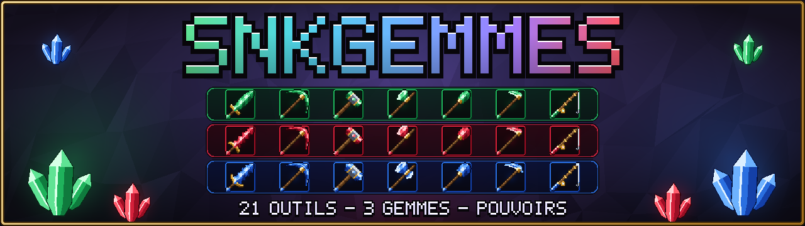
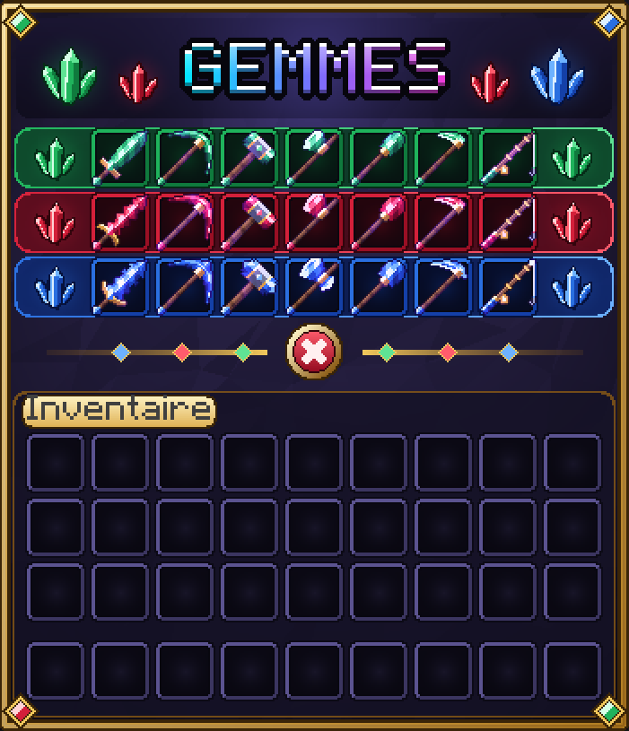
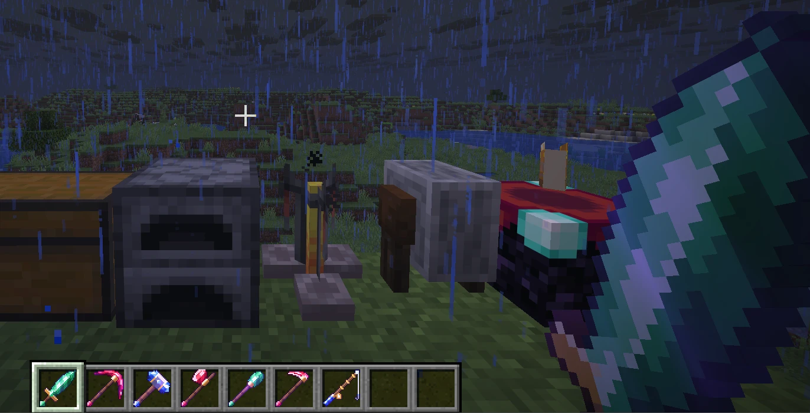

<b>21 outils en émeraude, rubis et saphir, chacun avec ses pouvoirs et ses textures.</b> 
Plugin Minecraft pour serveurs <b>Paper 1.21.4 à 26.3</b>, par <b>SnkAlex</b>.

<a href="#-les-gemmes">Gemmes</a> •
<a href="#-les-outils">Outils</a> •
<a href="#-captures">Captures</a> •
<a href="#-commandes">Commandes</a> •
<a href="#-compatibilité">Compatibilité</a> •
<a href="#-lobtenir">L'obtenir</a>

---

## 💎 Les gemmes

| Gemme | Rang | Résistance |
|---|---|---|
| 🟢 **Émeraude** | Rare | 3 fois la netherite |
| 🔴 **Rubis** | Épique | 5 fois la netherite |
| 🔵 **Saphir** | Légendaire | **Incassable** |

- Tous les outils sont **liés** : le joueur les garde à la mort, mais peut les jeter, les donner, les vendre ou les ranger
- Ils ont déjà leurs enchantements
- Noms, dégâts, zones, enchantements et pouvoirs se règlent dans un seul fichier

---

## ⚒️ Les outils

| Outil | 🟢 Émeraude | 🔴 Rubis | 🔵 Saphir |
|---|---|---|---|
| **Épée** | 10 de dégâts | 12 + feu | 14 + feu II |
| **Pioche** | Fortune I | Fortune II | Fortune III, **minerais déjà fondus** |
| **Marteau** (largeur × hauteur × profondeur) | 1 × 2 × 3 | 2 × 2 × 3 | **3 × 3 × 5** |
| **Hache** | 11 de dégâts | 13, abat l'arbre (64 bûches) | 15, abat l'arbre (**200 bûches**) |
| **Pelle** | 1 bloc | 2 × 2 | **3 × 3** |
| **Houe** | Récolte et replante | Zone 2 × 2 | Zone **3 × 3** et **vend la récolte** |
| **Canne à pêche** | Appât I | 25 % de prise double | **50 % de prise double** |

S'accroupir désactive le marteau, la pelle, la hache et la houe, pour casser normalement.

### 🌾 La houe en saphir vend toute seule
Avec Vault, elle vend les récoltes directement. Avec **[SnkMarche](https://github.com/SnkStudio/SnkMarche)**, elle suit les prix de la boutique et chaque joueur choisit ses cultures avec `/shop auto`.

### 🎨 Textures et menu dessinés
Les 21 outils ont leurs propres textures en 32 × 32, et le menu admin sa propre interface, grâce à un pack de ressources fourni. Sans le pack, les outils fonctionnent et ressemblent à ceux en netherite.

---

## 📸 Captures

 Le menu admin : un clic pour recevoir un outil

 L'épée en émeraude en main

---

## ⌨️ Commandes

| Commande | Effet |
|---|---|
| `/gemmes` | Menu de tous les outils |
| `/gemmes donner <joueur> <outil> <gemme> [nombre]` | Donne un outil (aussi depuis la console ou une boutique) |
| `/gemmes reload` | Recharge les réglages |

**Outils :** `epee` `pioche` `marteau` `hache` `pelle` `houe` `canne` — **Gemmes :** `emeraude` `rubis` `saphir`

**Permission :** `snkgemmes.admin`.

---

## 🧩 Compatibilité

| | |
|---|---|
| **Versions** | 1.21.4 à 26.3, un seul fichier pour toutes |
| **Testé sur** | Paper 1.21.4, 1.21.11, 26.2 et 26.3 |
| **Serveur** | Paper |
| **Java** | 21 ou plus (celui de ta version de Paper) |
| **Facultatif** | Vault et une économie, pour la vente de la houe |

**Va plus loin avec les autres plugins Snk** (facultatifs) :
- **[SnkQuetes](https://github.com/SnkStudio/SnkQuetes)** : des outils en gemme à gagner en récompense
- **[SnkPNJ](https://github.com/SnkStudio/SnkPNJ)** : des personnages avec dialogues, qui peuvent porter les outils en gemme
- **[SnkInterface](https://github.com/SnkStudio/SnkInterface)** : chat, TAB, tableau, hologrammes et menus
- **[SnkCosmetiques](https://github.com/SnkStudio/SnkCosmetiques)** : chapeaux, masques, ailes et compagnons en 3D
- **[SnkPass](https://github.com/SnkStudio/SnkPass)** : un pass de saison où l'on gagne les outils en gemme
- **[SnkBoutiques](https://github.com/SnkStudio/SnkBoutiques)** : boutiques-coffres des joueurs, pour revendre ses outils
- **[SnkMarche](https://github.com/SnkStudio/SnkMarche)** : boutique, promos et hôtel des ventes
- **[SnkClans](https://github.com/SnkStudio/SnkClans)** : clans, territoire et guerres

---

## 📦 Ce que tu reçois
- Le plugin (`.jar`)
- Le pack de ressources (textures des 21 outils et menu)
- Le guide d'installation et le guide complet, en français

Aucune connaissance en code n'est nécessaire : tout se règle dans un fichier.

---

## 📩 L'obtenir

Le plugin n'est pas en téléchargement libre. Pour le prix, une question ou une démonstration :

➡️ **[Écris-moi ici](../../issues/new/choose)** (il faut un compte GitHub, c'est gratuit)

> Les messages sont **publics** : n'écris ni adresse e-mail, ni mot de passe, ni information de paiement. On passe ensuite en privé.

---

© SnkAlex. Tous droits réservés. Voir <a href="LICENSE.md">la licence</a>. 
Ce plugin n'est pas un produit officiel Minecraft. Il n'est ni approuvé par Mojang ou Microsoft, ni associé à eux.

